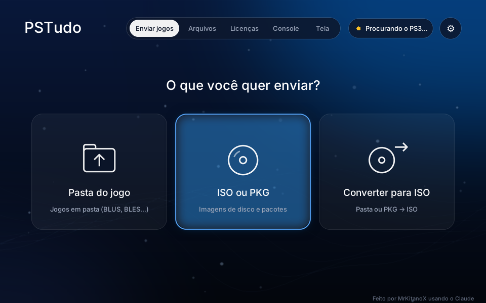
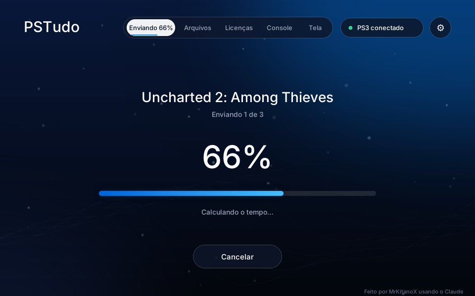
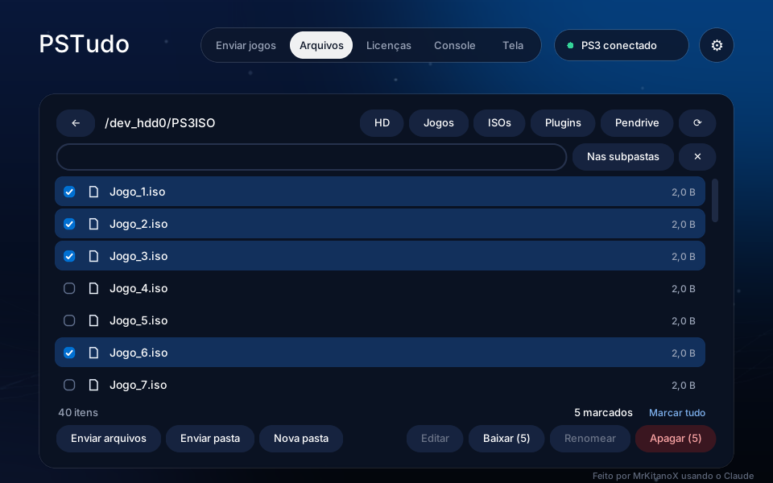
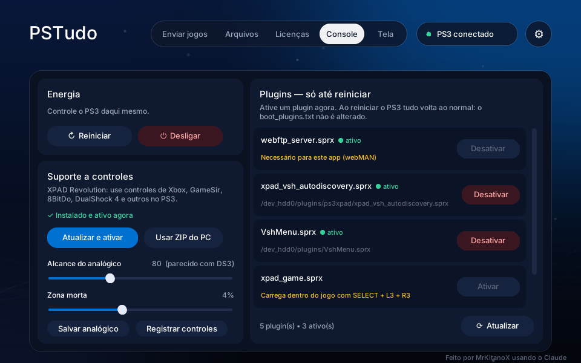
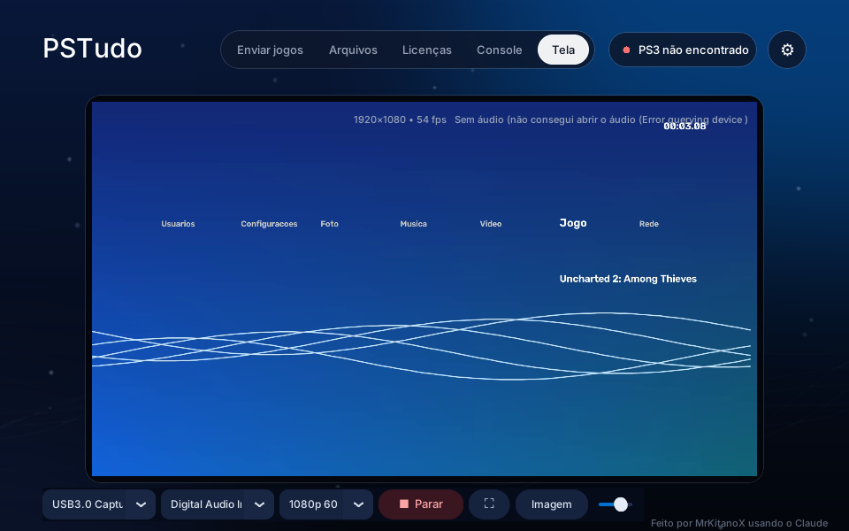

<p align="center">
  
</p>

<h1 align="center">PSTudo</h1>

<p align="center">
  Gerencie seu PS3 com HEN direto do PC: envie jogos pela rede, mexa nos arquivos do console,
  ative plugins, configure controles, converta jogos para ISO e espelhe a tela da placa de captura.
</p>

<p align="center">
  
</p>

> Feito por **MrKitanoX** usando o **Claude**.

---

## O que ele faz

| | |
|---|---|
| **Enviar jogos** | Envia jogos em pasta (BLUS, BLES…), ISOs e PKGs pela rede. Encontra o PS3 sozinho, mostra o nome real do jogo, escolhe a pasta certa (GAMES, PS3ISO, packages) e não reenvia o que já está no console. Dá para usar as outras abas durante o envio, e um som avisa quando termina. |
| **Converter para ISO** | Transforma jogos em pasta em ISO (com o `makeps3iso`) e, de forma experimental, PKGs de jogos de disco em ISO. |
| **Arquivos** | Gerenciador de arquivos do PS3: navegar, pesquisar (na pasta ou também nas subpastas), marcar vários itens de uma vez, enviar, baixar, renomear, criar pastas, apagar e editar arquivos de texto, como o `boot_plugins.txt`. As pastas do sistema ficam protegidas. |
| **Licenças** | Envia arquivos `.rap` direto para `/dev_hdd0/exdata`, ignorando arquivos inválidos. |
| **Console** | Reiniciar e desligar o PS3. Ativar e desativar plugins **só até reiniciar**, sem mexer no `boot_plugins.txt`. Instalar o [XPAD Revolution](https://github.com/GabaRSk/XPAD-Revolution), ajustar o analógico e registrar os controles ligados no PC no `xpad_devices.txt`. |
| **Tela** | Espelha a placa de captura com áudio, que continua ligada enquanto você usa as outras abas. A tela cheia é desenhada pela placa de vídeo, com **FSR 1** (nitidez) e **interpolação de quadros** (x2 a x6 os quadros do jogo, ou no Hz nativo do monitor), sem travar quando você transmite no Discord ou no OBS. |

<p align="center">
  
  
  
  
</p>

## Requisitos

- **PS3 com HEN** e o **[webMAN MOD](https://github.com/aldostools/webMAN-MOD)** instalado. O PSTudo conversa com o console pelo FTP e pelos comandos web do webMAN.
- PC com **Windows 10 ou 11**, na **mesma rede** do PS3. O cabo de rede no PS3 deixa os envios bem mais rápidos.
- Opcional, para a aba **Tela**: uma placa de captura ligada no PC e uma placa de vídeo com OpenGL 3.3 para a tela cheia.

## Como usar

1. Baixe o `PSTudo.exe` na página de [Releases](../../releases) e abra.
   - O Windows pode mostrar "O Windows protegeu o computador", porque o programa não tem assinatura digital. Clique em **Mais informações** e depois em **Executar assim mesmo**.
2. Ligue o PS3, ative o HEN e espere o webMAN carregar. O PSTudo encontra o console sozinho e mostra **PS3 conectado**.
3. Escolha uma pasta de jogo, uma ISO ou um PKG e clique em **Enviar para o PS3**.

Se o PS3 não for encontrado, clique no ⚙ e digite o IP do console.

A janela pode ser maximizada: a interface aumenta junto.

### Atalhos (dá para trocar no ⚙)

| Tecla | O que faz |
|---|---|
| `F` | Liga e desliga o FSR (na tela cheia da aba Tela) |
| `I` | Troca a interpolação de quadros (na tela cheia da aba Tela) |
| `Ctrl` + `Shift` + `F` / `I` | O mesmo, mas funciona com qualquer janela em foco (Discord, navegador…) |
| `Esc` | Sai da tela cheia |

## Rodar pelo código ou gerar o .exe

Precisa do **Python 3.12** no Windows.

```bat
git clone https://github.com/MrKitanoX/PSTudo.git
cd PSTudo
python -m pip install -r requirements.txt
python pstudo.py
```

Para gerar o `PSTudo.exe`, rode o `build.bat`. O arquivo sai na pasta `dist`.

## Perguntas comuns

**A aba Tela diz que não conseguiu abrir a placa.**
A placa de captura só funciona com um programa por vez. Feche o OBS ou qualquer outro programa que esteja usando a placa.

**A transmissão no Discord trava quando a tela cheia está em foco.**
Deixe ligada a opção **Compatível com Discord e OBS** (aba Tela → Imagem). Ela já vem ligada. Para trocar o FSR ou a interpolação sem tirar o foco do Discord, use `Ctrl` + `Shift` + a tecla do atalho.

**Posso transformar qualquer PKG em ISO?**
Não. Só jogos de disco que foram empacotados em PKG. Jogos da PSN (IDs que começam com `NP`) não têm versão de disco, e atualizações não são o jogo completo. Nesses casos, instale o PKG pelo PS3.

**O que a interpolação faz?**
Cria quadros intermediários a partir do movimento da imagem, deixando tudo mais fluido. `x2` dobra os quadros do jogo (30 → 60), `x4` quadruplica (30 → 120) e assim por diante, sempre em ritmo uniforme. `Nativo` acompanha o Hz do monitor, sincronizado com ele, e é o mais suave. Ela acrescenta um pouco de atraso (cerca de 1 quadro do jogo), então para jogos competitivos é melhor deixá-la desligada. Onde o movimento não dá para acompanhar (objeto aparecendo, explosão), o PSTudo mostra o quadro real em vez de misturar dois quadros, para não criar imagem dupla. O HUD e os textos parados ficam no lugar.

## Créditos

- **[makeps3iso](https://github.com/bucanero/ps3iso-utils)**, por Estwald, com builds mantidos por bucanero (GPLv3). O código e o executável estão em [`third_party/ps3iso-utils`](third_party/ps3iso-utils).
- **RCAS do AMD FidelityFX FSR 1** (MIT), adaptado para a nitidez da tela cheia.
- **[XPAD Revolution](https://github.com/GabaRSk/XPAD-Revolution)**, por GabaRSk. É baixado do GitHub oficial na hora da instalação e não vem junto com o PSTudo.
- **[webMAN MOD](https://github.com/aldostools/webMAN-MOD)**, por aldostools, que é o que roda no PS3.
- Bibliotecas Python: customtkinter, Pillow, OpenCV, NumPy, sounddevice, pygrabber, pygame-ce, ModernGL e PyCryptodome.

Os detalhes de cada licença estão em [THIRD_PARTY_NOTICES.md](THIRD_PARTY_NOTICES.md).

## Aviso

O PSTudo não tem nenhuma ligação com a Sony Interactive Entertainment. "PlayStation" e "PS3" são marcas da Sony. Use o programa apenas com jogos e licenças que você tem.

## Licença

[GNU General Public License v3.0](LICENSE): você pode usar, estudar, modificar e redistribuir o PSTudo, desde que as versões modificadas também sejam abertas sob a mesma licença.
